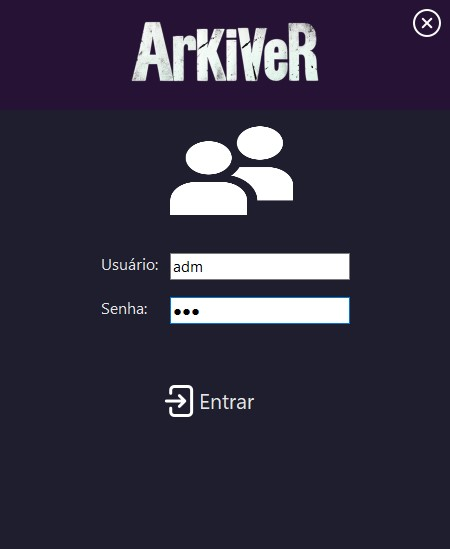
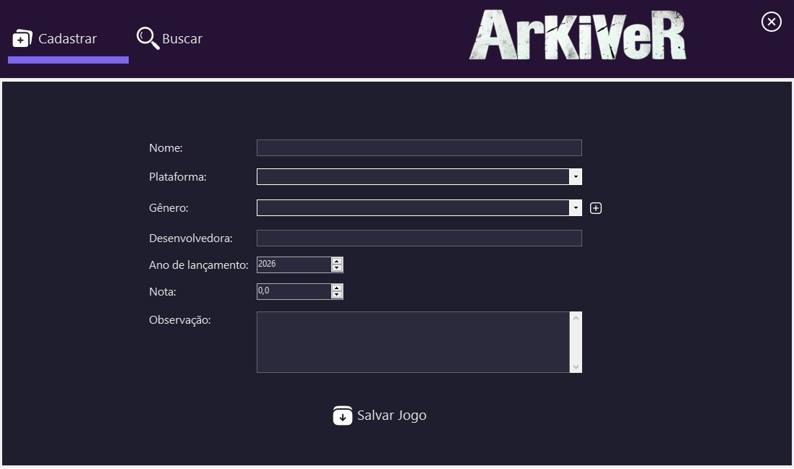
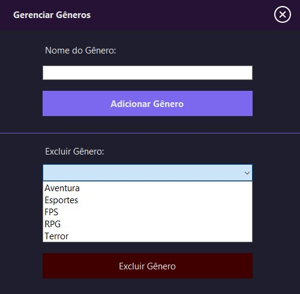
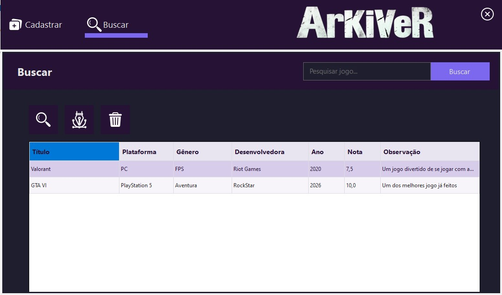

# ArKiVeR - Sistema de Cadastro de Games

Sistema elaborado como projeto final para a disciplina de LTP1 do professor Matheus Eloy. Desenvolvido na plataforma .NET em lang C#, banco de dados feito no MySQL WorkBench.

## Tela de Login

## Tela de Cadastro

Permite inserir os dados dos jogos, tela a parte para os gêneros.

## Listagem de Jogos

Lista os jogos e permite busca por título do game.

## Tecnologias

- C# com Windows Forms (.NET 10)
- MySQL (banco hospedado no Aiven) com stored procedures
- Biblioteca MySql.Data

## Como instalar e executar

### Requisitos

- Windows
- [.NET 10 SDK](https://dotnet.microsoft.com/download)
- Visual Studio com a carga de trabalho "Desenvolvimento para desktop com .NET" (a versão Community serve)

### Passo a passo

1. Clone o repositório:

   git clone https://github.com/oliveiraotaviodecamposfermino-sketch/ArKiVeR.git
   
2. Abra o arquivo `Projeto_Final.slnx` no Visual Studio. Os pacotes NuGet são restaurados automaticamente.
3. Abra o arquivo `Projeto_Final/ConectaBanco.cs` e troque `-senha-` na string de conexão pela senha do banco, enviada no comentário particular da atividade.
4. Pressione **F5** (ou **Ctrl+F5**) para executar. Pelo terminal, também funciona:
   
   dotnet run --project Projeto_Final
   

### Login

Na tela inicial, entre com:

- Usuário: `adm`
- Senha: `123`

### Banco de dados

O sistema se conecta a um banco MySQL na nuvem (Aiven). Para rodar localmente, execute o script [`banco/banco_arkiver.sql`](banco/banco_arkiver.sql) no MySQL Workbench e troque a string de conexão em `ConectaBanco.cs` para `server=localhost`.